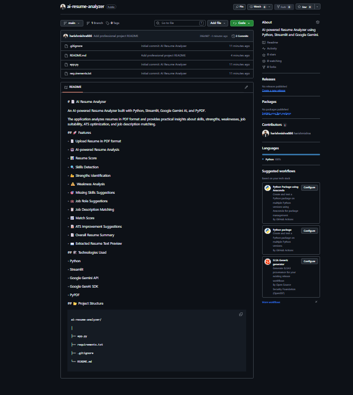

# 📄 AI Resume Analyzer

An AI-powered Resume Analyzer built with Python, Streamlit, Google Gemini AI, and PyPDF.

The application analyzes resumes in PDF format and provides practical insights about skills, strengths, weaknesses, job suitability, ATS optimization, and job description matching.

## 🚀 Features

- 📄 Upload Resume in PDF format
- 🤖 AI-powered Resume Analysis
- 📊 Resume Score
- 🔍 Skills Detection
- 💪 Strengths Identification
- ⚠️ Weakness Analysis
- 🎯 Missing Skills Suggestions
- 💼 Job Role Suggestions
- 📋 Job Description Matching
- 📈 Match Score
- 📝 ATS Improvement Suggestions
- 📑 Overall Resume Summary
- 📖 Extracted Resume Text Preview

## 🛠️ Technologies Used

- Python
- Streamlit
- Google Gemini API
- Google GenAI SDK
- PyPDF

## 📂 Project Structure

ai-resume-analyzer/
│
├── app.py
├── requirements.txt
├── .gitignore
├── screenshots/
│   └── ai-resume-analyzer-demo.png
└── README.md

## ▶️ How to Run

pip install -r requirements.txt
streamlit run app.py

## 🎯 Project Purpose

This project demonstrates how Generative AI can be used to analyze resumes and provide useful career-oriented insights, including ATS optimization and job description matching.